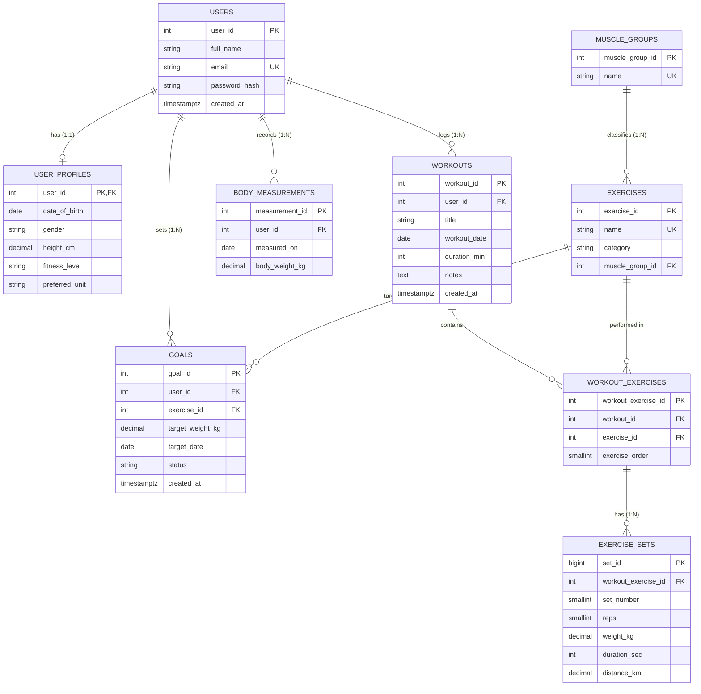

# 02 – ER Diagram and Data Modelling (PostgreSQL)

## 1. Entities, attributes and keys

| Entity (table) | Primary key | Foreign keys | Other key attributes |
|---|---|---|---|
| `users` | `user_id` | – | `email` (UNIQUE), `full_name`, `password_hash`, `created_at` |
| `user_profiles` | `user_id` | `user_id` → `users` | `date_of_birth`, `gender`, `height_cm`, `fitness_level`, `preferred_unit` |
| `muscle_groups` | `muscle_group_id` | – | `name` (UNIQUE) |
| `exercises` | `exercise_id` | `muscle_group_id` → `muscle_groups` | `name` (UNIQUE), `category` |
| `workouts` | `workout_id` | `user_id` → `users` | `title`, `workout_date`, `duration_min`, `notes` |
| `workout_exercises` | `workout_exercise_id` | `workout_id` → `workouts`, `exercise_id` → `exercises` | `exercise_order`; UNIQUE (`workout_id`,`exercise_id`) |
| `exercise_sets` | `set_id` | `workout_exercise_id` → `workout_exercises` | `set_number`, `reps`, `weight_kg`, `duration_sec`, `distance_km` |
| `goals` | `goal_id` | `user_id` → `users`, `exercise_id` → `exercises` | `target_weight_kg`, `target_date`, `status` |
| `body_measurements` | `measurement_id` | `user_id` → `users` | `measured_on`, `body_weight_kg`; UNIQUE (`user_id`,`measured_on`) |

## 2. Relationships

| Relationship | Type | Implemented by |
|---|---|---|
| `users` – `user_profiles` | **One-to-One** (a profile belongs to exactly one user; a user may have no profile yet) | `user_profiles.user_id` is both PK and FK |
| `users` – `workouts` | **One-to-Many** | `workouts.user_id` FK |
| `users` – `goals` | **One-to-Many** | `goals.user_id` FK |
| `users` – `body_measurements` | **One-to-Many** | `body_measurements.user_id` FK |
| `muscle_groups` – `exercises` | **One-to-Many** | `exercises.muscle_group_id` FK |
| `exercises` – `goals` | **One-to-Many** | `goals.exercise_id` FK |
| `workouts` – `exercises` | **Many-to-Many** (a workout has many exercises; an exercise is used in many workouts) | bridge table `workout_exercises` |
| `workout_exercises` – `exercise_sets` | **One-to-Many** | `exercise_sets.workout_exercise_id` FK |

## 3. ER diagram

> GitHub renders this Mermaid diagram automatically. To export an image for slides, paste the code into <https://mermaid.live>.

### Reading the notation
`||--o{` = one-to-many (one on the left, zero-or-many on the right). `||--o|` = one-to-zero-or-one. The M:N relationship between `WORKOUTS` and `EXERCISES` appears as two one-to-many links meeting at `WORKOUT_EXERCISES`.

## 4. Design notes
- **Why a bridge table?** A relational table cannot store a list in one cell. `workout_exercises` stores one row per *exercise in a workout*, and also carries `exercise_order`, an attribute of the relationship itself.
- **Why `exercise_sets` instead of columns like `set1_reps, set2_reps...`?** Repeating columns break 1NF and limit the number of sets. One row per set has no limit and is easy to aggregate.
- **Why nullable `reps/weight_kg/duration_sec/distance_km`?** One table serves strength (reps + weight) and cardio/timed work (duration + distance). A `CHECK` guarantees every set has at least reps or duration.
