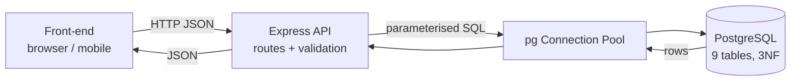

# 09 – Database Architecture and Implementation Decisions

## Architecture overview



The database holds three groups of tables:

| Group | Tables | Role |
|---|---|---|
| Accounts | `users`, `user_profiles` | Who is training |
| Reference data | `muscle_groups`, `exercises` | Shared catalogue |
| Activity | `workouts`, `workout_exercises`, `exercise_sets`, `goals`, `body_measurements` | What was done and what is targeted |

## Key decisions and reasons

| # | Decision | Reason |
|---|---|---|
| 1 | PostgreSQL (relational) | Structured, highly related, integrity-sensitive data (see doc 01) |
| 2 | Bridge table `workout_exercises` | Resolves the many-to-many between workouts and exercises and stores `exercise_order` |
| 3 | One row per **set** | Satisfies 1NF; unlimited sets; easy `SUM/MAX` |
| 4 | Nullable reps / weight / duration / distance with a `CHECK` | One table handles strength and cardio while still guaranteeing meaningful rows |
| 5 | Separate `muscle_groups` and `exercises` lookup tables | 3NF: removes transitive dependency; enables consistent filtering and statistics |
| 6 | `user_profiles` as a 1:1 table | Keeps authentication data separate from optional personal data |
| 7 | `NUMERIC(6,2)` for weights/distances | Exact decimal arithmetic, no floating-point drift |
| 8 | Surrogate identity keys + natural keys as `UNIQUE` | Simple single-column FKs without losing business rules |
| 9 | `CASCADE` for owned data, `RESTRICT` for shared catalogue | No orphans, no accidental history loss |
| 10 | Derived values (volume, PRs) computed in queries, not stored | Avoids inconsistency; materialized views are available if needed |
| 11 | Raw `pg` driver with parameterised SQL | Full control, easy to explain every query, safe against injection |
| 12 | Transactions for multi-table writes | Atomic "log workout" |

## Repository layout

```
DE/
├── README.md
├── 01_database_selection_and_justification.md
├── 02_er_diagram.md
├── 03_normalization.md
├── 04_final_schema.md
├── 05_queries_and_outputs.md
├── 06_sample_records.md
├── 07_database_backend_integration.md
├── 08_integrity_and_performance.md
├── 09_architecture_and_design_decisions.md
├── 10_viva_preparation.md
├── sql/            01_schema.sql · 02_seed.sql · 03_queries.sql · 04_integrity_tests.sql · run_all.sh
├── integration/    Express + pg backend layer
└── evidence/       screenshots / terminal output you add
```
